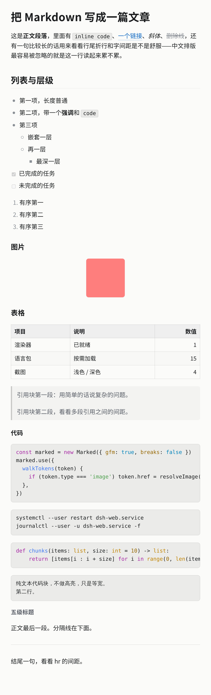

# dsh-mdview

DeepSeek Harness 右侧栏的 Markdown **只读**预览，自带一套排版，替掉内置的 Markdown 视图。
不做编辑。



## 安装

**命令行**：

```sh
dsh plugin --profile web add github:yinguobing/dsh-mdview
```

**Web UI**：打开 **Plugins → Add plugin → Install a third-party plugin**，输入
`github:yinguobing/dsh-mdview`，点 **Enable now**。

装完**重启一次** `dsh web`——它在进程启动时组合插件。重启会用新的访问令牌，浏览器里的旧地址会 401，用启动日志里打印的那个 URL。

之后的改动不用重启：bundle 的 rev 变了，刷新页面即可。

## 用起来

`.md` 默认就用这套排版。预览工具栏的下拉里仍能选回内置的「Markdown」，想对比随时切。

正文 20px、行高 1.6、段间距 1em、行宽上限 36em、左对齐；代码高亮用 One Light / One Dark 跟随深浅色。在下拉里叫**精排版**（英文 `Typeset`），和内置的 Markdown 并列。

参数还在调。想改就动 [`src/styles.css`](src/styles.css)，改完：

```sh
pnpm add -D esbuild   # 只有第一次需要
node build.mjs
```

## 开发

```
src/index.jsx    注册 + marked 配置 + 正文组件（含相对图片解析）
src/styles.css    全部排版
build.mjs        esbuild → CJS bundle，套上 window.__ModuleLoader__.load
lib/client.js    构建产物，已入库，clone 下来直接可用
```

插件挂在 `@deepseek-ai/dsh-client-ui-sidebar-documentpreview` 的 `documentPreviews` 扩展点上，`priority: 'extension'` 压过内置实现；文件读取、自动刷新、分页、相对图片鉴权全部复用宿主。

### ⚠️ 一个能搞挂整个应用的坑

client 半边必须声明 cordis 服务注入：

```js
module.exports = { apply, inject: ['documentPreviews', 'slots'] }
```

漏了会抛 `cannot get property "documentPreviews" without inject`，而 **DSH web boot 把「client entry failed」当致命错误**——不是插件不出现，是整个应用不挂载。

注意 `package.json` 里的 `dsh.client.inject` 是**模块依赖**，跟这个服务注入是两回事。
